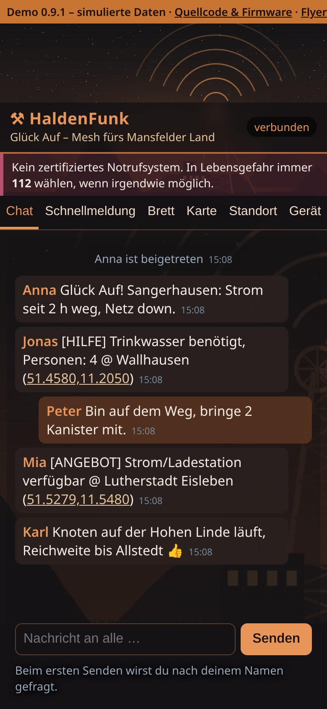
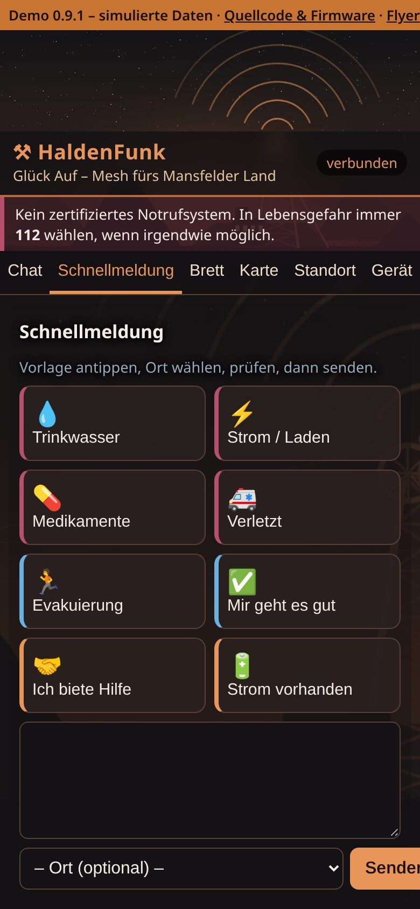
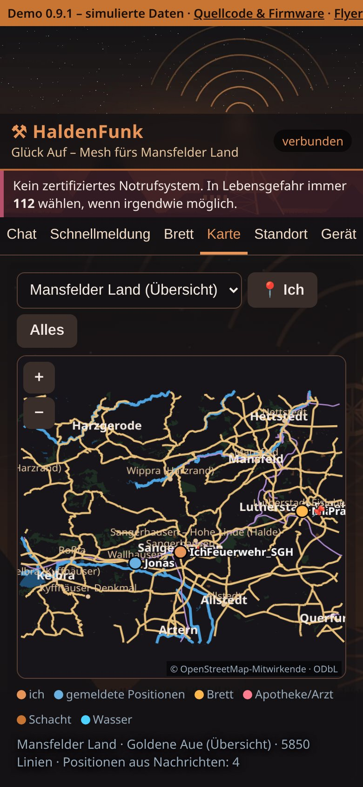

# HaldenFunk – Glück Auf

**Glück Auf – Mesh fürs Mansfelder Land: Offline-Chat über LoRa-Funk für Sangerhausen, Eisleben, die Goldene Aue und den Harzrand – Regionalvariante von DisAHRsterRadio, ohne MeshCore.**

Aufnahmen der [Live-Demo](https://pietwars.github.io/HaldenFunk/), Stand 0.9.1; alle Daten simuliert (Handygröße).

**Version 0.9.1** · disaster-radio/LoRaLayer2 + RadioLib 7 · 868 MHz

Flyer (A5): [Druck-PDF mit QR-Codes](docs/flyer/HaldenFunk-Flyer.pdf) · [Digital-PDF mit Links](docs/flyer/HaldenFunk-Flyer-digital.pdf)

## Was kann es

- **Chat an alle** im Browser – ohne App, ohne Internet (Chat reicht ein Funk-Sprung weit)
- **Schnellmeldungen:** Trinkwasser, Strom, Medikamente, Verletzt, Evakuierung, „Mir geht es gut“, Angebote
- **Schwarzes Brett:** Aushänge werden auf jedem Gerät gespeichert (bis 30) und über mehrere Geräte weitergereicht
- **Standort:** Handy-GPS oder Ortsliste von Sangerhausen bis Stolberg (Harzrand)
- **Offlinekarten:** Mansfelder Land · Goldene Aue, Sangerhausen, Lutherstadt Eisleben, Mansfeld · Hettstedt, Kelbra · Roßla · Kyffhäuser – Halden und Schächte hervorgehoben
- **Fünf Funkprofile** für 868 MHz mit Sendezeit-Buchführung (10 %); Gestaltung in Kupfer und Anthrazit

## Unterstützte Geräte

| Board | Paket im [Release v0.9.1](https://github.com/Pietwars/HaldenFunk/releases/tag/v0.9.1) | Stand |
|---|---|---|
| Heltec WiFi LoRa 32 V2 (ESP32, SX1276, 868 MHz) | `HaldenFunk-0.9.1-heltec-v2.zip` | baut und ist automatisch geprüft; auf Hardware ungeprüft |

LILYGO T3-S3 und T3 V1.6.1 bleiben im Code und im CI, sind aber nicht im Release – siehe [Details](docs/DETAILS.md#unterstützte-boards).

**Ab dem nächsten Release (vorbereitet):** nur noch **LILYGO T-Deck Plus** (`…-tdeck.zip`) und **LILYGO T-Watch S3** (`…-twatch-s3.zip`), beide ESP32-S3 + SX1262 (Kern-Anpassung aus DisAHRsterRadio). Das Display bleibt dort vorerst dunkel; Bedienung über WLAN im Browser. Heltec V2 und die T3-Boards werden dann nicht mehr gebaut (Profile bleiben im Code, das Release v0.9.1 bleibt unverändert).

## Schnellstart

1. **Flashen:** ZIP aus dem [Release](https://github.com/Pietwars/HaldenFunk/releases/tag/v0.9.1) entpacken und `HaldenFunk-0.9.1-heltec-v2-factory.bin` an Adresse **0x0** schreiben (z. B. mit [esptool-js](https://espressif.github.io/esptool-js/), Anleitung als `ANLEITUNG.md` im ZIP). Update ohne Datenverlust: nur `teile/firmware.bin` an 0x10000.
2. **Verbinden:** Handy mit dem offenen WLAN `HaldenFunk-XXXXXX` verbinden, **http://192.168.4.1** (oder http://haldenfunk.local) öffnen – kein Passwort, höchstens 4 Handys.

Keine MeshCore-App: Diese Firmware nutzt LoRaLayer2 (Bluetooth nur in separaten `*-ble`-Testprofilen). Mehr: [Offener Zugang](docs/OFFENER_ZUGANG.md)

## Funk

Standardprofil **EU Narrow: 869,618 MHz**, 62,5 kHz, SF8, CR 4/8, 14 dBm (SRD-Teilband 869,4–869,65 MHz, 10 % Sendezeit). Alle Geräte eines Netzes brauchen dasselbe Profil. Funkt mit DisAHRsterRadio, **nicht** mit MeshCore- oder Meshtastic-Geräten. Alle Profile: [Details](docs/DETAILS.md#funkprofile-868-mhz-deutschland)

<!-- projektfamilie:start (in allen fünf Repositorys identisch; erzeugt mit DisasterMesh/tools/projektfamilie.py) -->
## Projektfamilie DisAHRsterRadio / HaldenFunk

| Repository | Inhalt | Funk | Version | Demo · Download · Flyer |
|---|---|---|---|---|
| [Pietwars/DisasterMesh](https://github.com/Pietwars/DisasterMesh) | Original-Repo: MeshCore 1.18 mit der großen Weboberfläche MeshAhrtal, Karten, Werkzeuge, Doku (Ahrtal) | MeshCore | 0.9.2 | [Live-Demo](https://pietwars.github.io/DisasterMesh/demo/) · [Release v0.9.2](https://github.com/Pietwars/DisasterMesh/releases/tag/v0.9.2) · Flyer [Druck](https://pietwars.github.io/DisasterMesh/flyer/DisasterMesh-Flyer.pdf) / [digital](https://pietwars.github.io/DisasterMesh/flyer/DisasterMesh-Flyer-digital.pdf) |
| [Pietwars/DisAHRsterRadio-MeshCore](https://github.com/Pietwars/DisAHRsterRadio-MeshCore) | MeshCore 1.18 mit kompakter MeshAhrtal-Oberfläche per WLAN plus Bluetooth für die MeshCore-App; Firmware für LILYGO T-Deck Plus und Heltec V2 (Ahrtal) | MeshCore | 0.9.1 | [Live-Demo](https://pietwars.github.io/DisAHRsterRadio-MeshCore/) · [Release v0.9.1](https://github.com/Pietwars/DisAHRsterRadio-MeshCore/releases/tag/v0.9.1) · Flyer [Druck](https://pietwars.github.io/DisAHRsterRadio-MeshCore/flyer/DisAHRsterRadio-MeshCore-Flyer.pdf) / [digital](https://pietwars.github.io/DisAHRsterRadio-MeshCore/flyer/DisAHRsterRadio-MeshCore-Flyer-digital.pdf) |
| [Pietwars/DisAHRsterRadio](https://github.com/Pietwars/DisAHRsterRadio) | Ohne MeshCore: modernisiertes disaster-radio (LoRaLayer2, RadioLib) mit kompakter MeshAhrtal-Oberfläche (Ahrtal) | LoRaLayer2 | 0.9.1 | [Live-Demo](https://pietwars.github.io/DisAHRsterRadio/) · [Release v0.9.1](https://github.com/Pietwars/DisAHRsterRadio/releases/tag/v0.9.1) · Flyer [Druck](https://pietwars.github.io/DisAHRsterRadio/flyer/DisAHRsterRadio-Flyer.pdf) / [digital](https://pietwars.github.io/DisAHRsterRadio/flyer/DisAHRsterRadio-Flyer-digital.pdf) |
| [Pietwars/HaldenFunk](https://github.com/Pietwars/HaldenFunk) | Regionalvariante von DisAHRsterRadio für Sangerhausen / Mansfelder Land, ohne MeshCore | LoRaLayer2 | 0.9.1 | [Live-Demo](https://pietwars.github.io/HaldenFunk/) · [Release v0.9.1](https://github.com/Pietwars/HaldenFunk/releases/tag/v0.9.1) · Flyer [Druck](https://pietwars.github.io/HaldenFunk/flyer/HaldenFunk-Flyer.pdf) / [digital](https://pietwars.github.io/HaldenFunk/flyer/HaldenFunk-Flyer-digital.pdf) |
| [Pietwars/HaldenFunk-MeshCore](https://github.com/Pietwars/HaldenFunk-MeshCore) | Regionalvariante von DisAHRsterRadio-MeshCore für das Mansfelder Land: MeshCore 1.18, WLAN + Bluetooth, Gerätematrix | MeshCore | 0.9.1 | [Live-Demo](https://pietwars.github.io/HaldenFunk-MeshCore/) · [Release v0.9.1](https://github.com/Pietwars/HaldenFunk-MeshCore/releases/tag/v0.9.1) · Flyer [Druck](https://pietwars.github.io/HaldenFunk-MeshCore/flyer/HaldenFunk-MeshCore-Flyer.pdf) / [digital](https://pietwars.github.io/HaldenFunk-MeshCore/flyer/HaldenFunk-MeshCore-Flyer-digital.pdf) |

Gleiche Spalte **Funk** = Geräte können miteinander funken (gleiches Funkprofil vorausgesetzt). MeshCore- und LoRaLayer2-Varianten verstehen sich **nicht**.

**Namen:** **DisAHRsterRadio** = Projekt und Marke (WLAN `DisAHRsterRadio-XXXXXX`) · **MeshAhrtal** = die Weboberfläche im Handy-Browser · **DisasterMesh** = das Original-Repository · **HaldenFunk – Glück Auf** = Regionalvariante fürs Mansfelder Land (WLAN `HaldenFunk-XXXXXX`).

Alle Demos sind simuliert.
<!-- projektfamilie:end -->

## Sicherheit

> ⚠️ Prototyp, **kein zertifiziertes Notrufsystem**. Im Notfall immer **112** wählen. Offenes, unverschlüsseltes WLAN und Funk: Jede Person in Reichweite kann mitlesen und senden.

## Mehr Doku

[Details (ausführlich, inkl. Grenzen)](docs/DETAILS.md) · [Offener Zugang](docs/OFFENER_ZUGANG.md) · [Kern und Region](docs/KERN_UND_REGION.md) · [Änderungen](CHANGELOG.md) · [Original-README disaster-radio](README.upstream.md)

## Lizenz

Grundlage: [sudomesh/disaster-radio](https://github.com/sudomesh/disaster-radio) und [LoRaLayer2](https://github.com/sudomesh/LoRaLayer2) – danke an Sudo Mesh. Kern aus [DisAHRsterRadio](https://github.com/Pietwars/DisAHRsterRadio). `firmware/`: GPLv3 und AGPLv3 (dual, wie upstream); `web/`: AGPLv3. Kartendaten © OpenStreetMap-Mitwirkende, [ODbL 1.0](web/static/map/ODbL-1.0.txt). Bilder: eigene, programmatisch erzeugte Grafiken.
