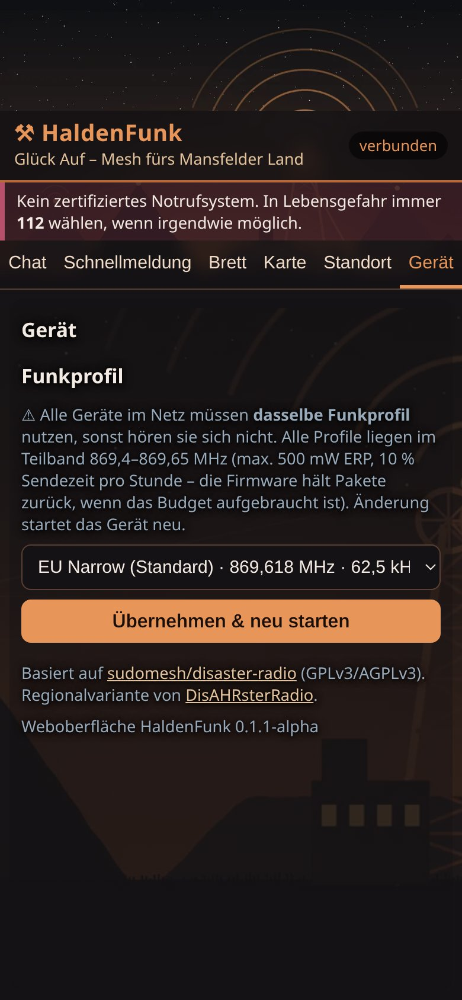
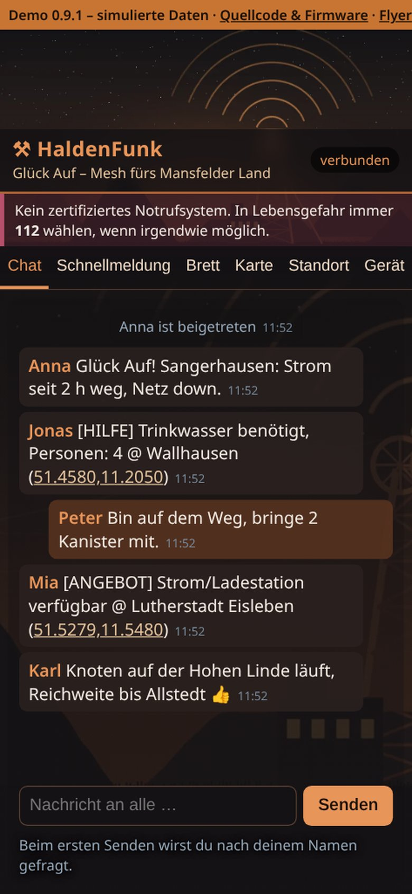
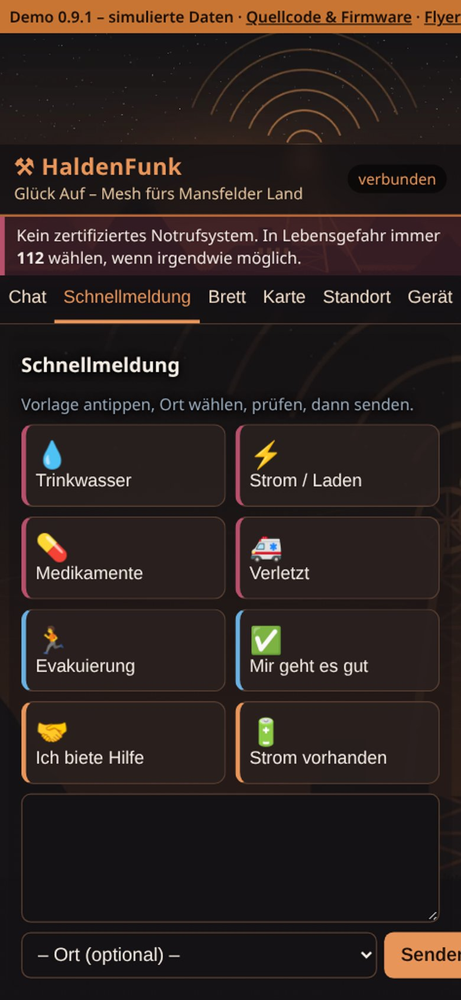
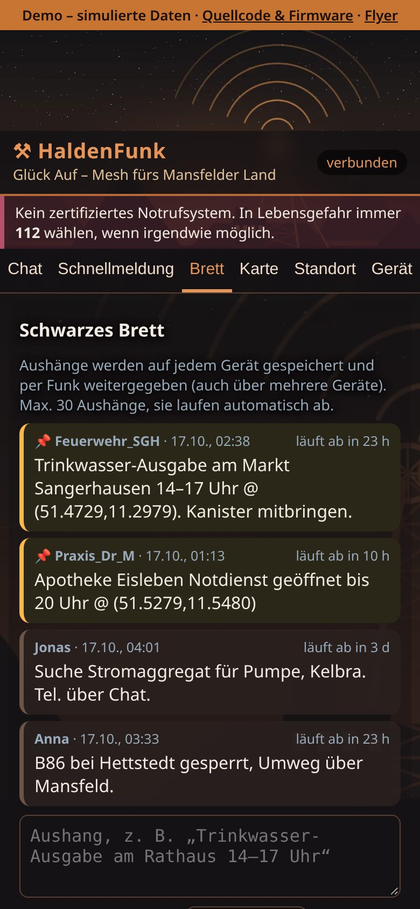
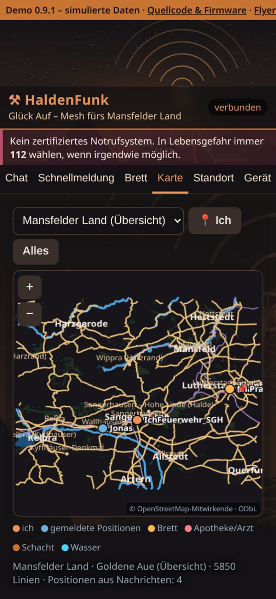
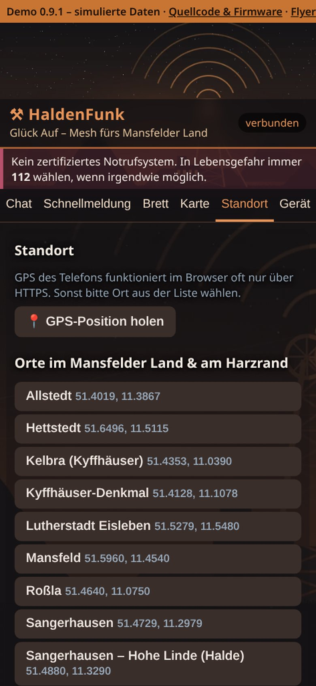
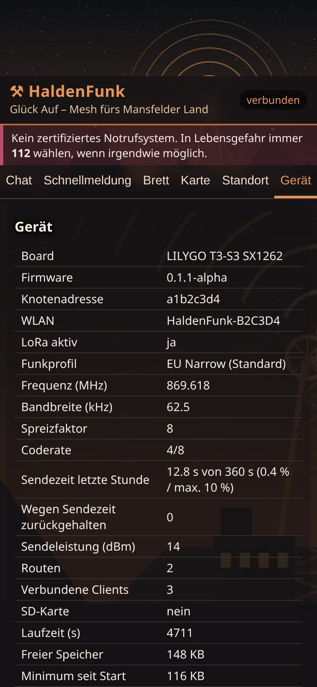
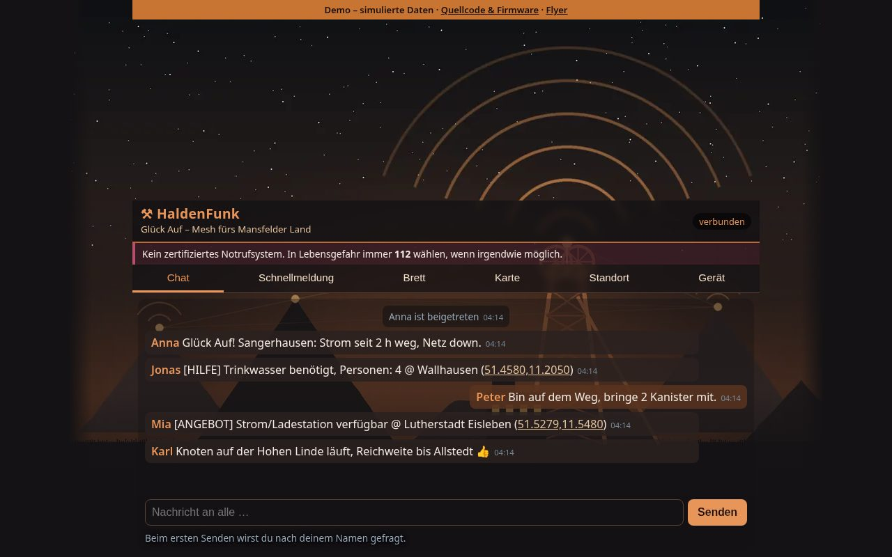

# HaldenFunk – Details

> Ausführliche Fassung der früheren README (Stand Oktober 2026). Die kurze Übersicht steht in der [README](../README.md); Versionsangaben gelten dort.

> **Aktueller Stand:** offenes WLAN `HaldenFunk-XXXXXX` → `http://192.168.4.1` bzw. `http://haldenfunk.local` – einfach verbinden, nichts eingeben. Zusätzliche `*-ble`-Testprofile bieten BLE-UART ohne PIN. [Zugang, Update und Abnahme](OFFENER_ZUGANG.md).

**Glück Auf – Mesh fürs Mansfelder Land**

**🔴 Live-Demo (simulierte Daten, kein Gerät nötig): https://pietwars.github.io/HaldenFunk/**


**Offline-Chat über LoRa-Mesh für Sangerhausen, das Mansfelder Land, die Goldene Aue und den Harzrand.** Ein Gerät spannt ein eigenes WLAN auf, man verbindet sich mit dem Handy und schreibt im Browser. Die Nachrichten laufen per LoRa von Gerät zu Gerät weiter – ganz ohne Internet, Strom aus der Steckdose oder Mobilfunk. Ideale Standorte für Knoten: Halden, Fördertürme, Kirchtürme, Dächer am Harzrand.

HaldenFunk ist die **Regionalvariante von [Pietwars/DisAHRsterRadio](https://github.com/Pietwars/DisAHRsterRadio)** (ein modernisierter Fork von [sudomesh/disaster-radio](https://github.com/sudomesh/disaster-radio), **ohne MeshCore**). Technik und Funkprotokoll sind identisch – HaldenFunk-Geräte verstehen sich mit DisAHRsterRadio-Geräten auf gleicher Frequenz. Neu sind Name, Gestaltung, Ortsliste und Karten.

> ⚠️ **Wichtig:** HaldenFunk ist **kein zertifiziertes Notrufsystem** und ersetzt keine Behörden-Kommunikation. In Lebensgefahr immer **112** wählen, wenn irgendwie möglich.

## Ehrlicher Stand (Oktober 2026)

| Punkt | Stand |
|---|---|
| Firmware baut für alle 3 Boards | ✅ CI „Firmware-Build“ (4 Profile inkl. Heltec-Alternative); Pakete im Release |
| Auf echter Hardware getestet | ❌ HaldenFunk selbst noch nicht; die gleiche Basis lief bei DisAHRsterRadio auf einem LILYGO T3 V1.6.1 |
| Funkverbindung zwischen zwei Geräten | ❓ ungetestet |
| Kompatibel mit DisAHRsterRadio | ✅ gleiches Protokoll und gleiche Standardfrequenz |
| Kompatibel mit MeshCore/Meshtastic | ❌ nein |

## Unterstützte Boards

| PlatformIO-Env | Board | Funkchip | Paket im Release |
|---|---|---|---|
| `t3s3-sx1262` | LILYGO T3-S3 | SX1262 | – (nicht im Release) |
| `t3-v161-sx1276` | LILYGO / TTGO T3 V1.6.1 | SX1276 | – (nicht im Release) |
| `heltec-v2-sx1276` | Heltec WiFi LoRa 32 V2 | SX1276 | – (ab 0.9.2 nicht mehr im Release; letztes Paket in v0.9.1) |
| `tdeck-sx1262` | LILYGO T-Deck Plus (im Release ab 0.9.2, ohne Display-Treiber) | SX1262 | `HaldenFunk-<Version>-tdeck.zip` |
| `twatch-s3-sx1262` | LILYGO T-Watch S3 (im Release ab 0.9.2, ohne Display-Treiber) | SX1262 | `HaldenFunk-<Version>-twatch-s3.zip` |

CI und Release bauen nach der T-Deck/T-Watch-Anpassung nur noch `tdeck-sx1262` und `twatch-s3-sx1262`; die übrigen Profile bleiben im Code.
| `heltec-v2-sx1276-wifi11` | Heltec WiFi LoRa 32 V2, WLAN mit 11 statt 8,5 dBm (falls das WLAN zu schwach ist) | SX1276 | – (nur CI-Artefakt / selbst bauen) |

Jedes ZIP enthält `factory.bin` (ab Adresse 0x0), die Einzelteile, `SHA256SUMS` und eine `ANLEITUNG.md` (Flashen im Browser mit esptool-js). Releases entstehen mit dem Workflow „Release“ bei jedem Tag `v*` und heißen `HaldenFunk-<Version>-<Board>.zip`. Ab 0.9.2 enthält das Release nur die Pakete für **LILYGO T-Deck Plus** und **LILYGO T-Watch S3**; die übrigen Profile bleiben im Code, ältere Releases unverändert. Die `factory.bin` an 0x0 überschreibt alle Einstellungen.

## Funkprofile (868 MHz, Deutschland)

Alle Profile liegen vollständig im SRD-Teilband **869,4–869,65 MHz** (ETSI EN 300 220 / BNetzA-Allgemeinzuteilung): **max. 500 mW ERP, 10 % Sendezeit**. Die Firmware führt Buch über die Sendezeit der letzten Stunde (RadioLib `getTimeOnAir`) und **hält Pakete zurück**, sobald das 10-%-Budget (360 s/h) erreicht ist. Sendeleistung bleibt bei 14 dBm (Standard, nie über Chipgrenze 22 dBm SX1262 / 20 dBm SX1276).

> ⚠️ **Alle Geräte eines Netzes müssen dasselbe Funkprofil nutzen**, sonst hören sie sich nicht. Auswahl im Reiter **Gerät → Funkprofil** (gespeichert im NVS, Neustart) oder seriell `/set preset N`.

> ℹ️ Die Funkprofile sind ab Release 0.9.1 enthalten. Die ältere Release-Firmware 0.1.1-alpha funkt fest mit 869,525 MHz, 125 kHz, SF9, CR 4/5 (entspricht Profil 2 „Mittel“). Wer alte und neue Geräte mischt, stellt die neueren Geräte auf „Mittel“ oder aktualisiert alle.

| Nr. | Profil | Frequenz | Bandbreite | SF | CR | Sendezeit je 100-Byte-Nachricht | max. Nachrichten/h (10 %) | Reichweite ↔ Tempo |
|---|---|---|---|---|---|---|---|---|
| 0 | **EU Narrow (Standard)** | 869,618 MHz | 62,5 kHz | 8 | 4/8 | ca. 0,94 s | ca. 385 | ausgewogen, störfest (MeshCore-Standard „EU/UK Narrow“) |
| 1 | Nah/Schnell | 869,525 MHz | 250 kHz | 7 | 4/5 | ca. 0,09 s | ca. 4100 | kurze Reichweite, sehr schnell |
| 2 | Mittel (bisheriger Standard) | 869,525 MHz | 125 kHz | 9 | 4/5 | ca. 0,55 s | ca. 650 | mittel; kompatibel zu Geräten mit alter Firmware |
| 3 | Fern | 869,525 MHz | 125 kHz | 12 | 4/8 | ca. 5,9 s | ca. 60 | größte Reichweite, sehr langsam (LDRO automatisch) |
| 4 | LongFast-ähnlich | 869,525 MHz | 250 kHz | 11 | 4/5 | ca. 0,94 s | ca. 380 | wie Meshtastic „LongFast“ EU; trotzdem nicht Meshtastic-kompatibel |



Sendezeiten berechnet mit expliziter Kopfzeile, CRC, 8 Symbolen Präambel. Funkeinstellungen: Syncword unverändert (privat), CRC an, explizite Kopfzeile, Low-Data-Rate-Optimierung automatisch, SX1262 mit „boosted RX gain“, TCXO 1,8 V (T3-S3), Strombegrenzung 140 mA (SX1262) / 120 mA (SX1276). `/api/info` liefert `preset`, `presetName`, `freq`, `bw`, `sf`, `cr`, `airtimeMs`, `airtimeBudgetMs`, `airtimePct`, `txDeferred`; `/api/presets` listet alle Profile, `POST /api/preset` (`preset=N`) speichert und startet neu.

## Weboberfläche

| Chat | Schnellmeldung | Brett |
|---|---|---|
|  |  |  |
| **Karte** | **Standort** | **Gerät** |
|  |  |  |



(Aufnahmen der [Live-Demo](https://pietwars.github.io/HaldenFunk/); alle Daten simuliert.)

- **Gestaltung:** Kupfer und Anthrazit, Spitzkegelhalden, Förderturm als Mesh-Knoten, Funkwellen. Das Hintergrundbild ist eine eigene, mit Python/PIL erzeugte Grafik (`tools/make_bg.py`), keine Fotos
- **Chat** an alle in Funkreichweite, **Schnellmeldungen** (Trinkwasser, Strom, Medikamente, Verletzt, Evakuierung, „Mir geht es gut“, Angebote)
- **Schwarzes Brett** mit Weitergabe über mehrere Geräte (LittleFS, max. 30 Aushänge, Ablaufzeit 6 h – 7 Tage)
- **Standort:** GPS des Telefons oder Ortsliste – Sangerhausen, Hohe Linde, Wallhausen, Kyffhäuser-Denkmal, Kelbra, Roßla, Allstedt, Lutherstadt Eisleben, Mansfeld, Hettstedt, Wippra, Stolberg (Harzrand)
- **Offline-Karten** (zusammen ca. 223 KB gzip im LittleFS, Übersicht 90 KB): Mansfelder Land · Goldene Aue (Übersicht), Sangerhausen, Lutherstadt Eisleben, Mansfeld · Hettstedt, Kelbra · Roßla · Kyffhäuser. Halden (braun) und Schächte (kupfer) werden hervorgehoben. Erzeugt mit `tools/make_map_osm.py` aus OpenStreetMap, Datenstand 17.10.2026, danach verkleinert mit `tools/shrink_maps.py` (Linien vereinfacht, Koordinaten gerastert, kleine Wald-/Wasserflächen und kurze Wegstücke weggelassen; Orte, Halden und Schächte vollständig) – gleiche Kartendateien wie in [HaldenFunk-MeshCore](https://github.com/Pietwars/HaldenFunk-MeshCore)
- Geräteinfo über `GET /api/info`, Demo lokal mit `web/static/index.html?demo=1`

## Erste Schritte

**Am einfachsten:** passendes ZIP aus dem [Release](https://github.com/Pietwars/HaldenFunk/releases/tag/v0.9.1) laden und nach `ANLEITUNG.md` flashen.

Selbst bauen:

```bash
pip install platformio
cd firmware
pio run -e t3s3-sx1262 -t upload      # Firmware
pio run -e t3s3-sx1262 -t uploadfs    # Weboberfläche (LittleFS)
pio device monitor                     # zeigt WLAN-Name und offenen Zugang
```

Dann mit dem offenen WLAN `HaldenFunk-XXXXXX` verbinden und `http://192.168.4.1` öffnen. Betreiberkonsole nur über USB; Telnet ist deaktiviert.

Standard-Funkprofil (ab 0.9.1): **EU Narrow** – 869,618 MHz, 62,5 kHz, SF8, CR 4/8, 14 dBm; weitere Profile siehe [Funkprofile](#funkprofile-868-mhz-deutschland). Ältere Release-Firmware 0.1.1-alpha: 869,525 MHz, 125 kHz, SF9, CR 4/5.

## Gemeinsamer Kern mit DisAHRsterRadio

HaldenFunk wird nicht als zweite Kopie gepflegt: Alle Kern-Dateien (Firmware, Web-Oberfläche, Werkzeuge, Workflows) entsprechen exakt [DisAHRsterRadio](https://github.com/Pietwars/DisAHRsterRadio) in der Revision aus `region/CORE` plus dem regionalen Overlay `region/overlay.patch`. CI prüft das bei jedem Build (`python3 tools/core_sync.py --check`). Neuen Kern übernehmen: `python3 tools/core_sync.py --update`. Details: [docs/KERN_UND_REGION.md](KERN_UND_REGION.md).

## Bekannte Grenzen

- Nicht auf Hardware getestet; Pinbelegungen von DisAHRsterRadio übernommen
- Chat nur Einzelsprung (LoRaLayer2 leitet Broadcasts nicht weiter); nur das Brett wird über mehrere Geräte weitergereicht
- Keine Verschlüsselung/Signatur – alle auf der Frequenz können mitlesen und Namen fälschen
- Karten ohne Navigation und ohne Gebäude in der Übersicht
- Weitere Grenzen wie bei [DisAHRsterRadio](https://github.com/Pietwars/DisAHRsterRadio#bekannte-grenzen--offene-arbeit)

## Lizenz, Quellen und Danksagung

- Grundlage: [sudomesh/disaster-radio](https://github.com/sudomesh/disaster-radio) und [sudomesh/LoRaLayer2](https://github.com/sudomesh/LoRaLayer2) – vielen Dank an Sudo Mesh. Git-Historie bleibt erhalten, Original-README: [README.upstream.md](../README.upstream.md)
- `firmware/`: GPLv3 und AGPLv3 (dual, wie upstream); `web/`: AGPLv3
- **Kartendaten:** © OpenStreetMap-Mitwirkende, [ODbL 1.0](../web/static/map/ODbL-1.0.txt)
- **Bilder:** Hintergrund, Kopfbild und Icon sind eigene, programmatisch erzeugte Grafiken (`tools/make_bg.py`). Es werden keine Fotos von Wikimedia Commons oder anderen Quellen verwendet

